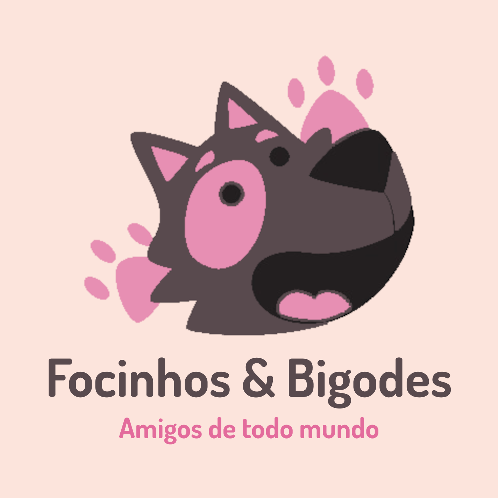

<p align="center">
  
</p>

<h1 align="center">Focinhos & Bigodes</h1>

<p align="center">
  Sistema web de gestão e atendimento para um PetShop: loja de produtos, serviços de banho e tosa, cadastro de pets e vacinas, tudo em um só lugar.
</p>

---

## Sobre o projeto

**Focinhos & Bigodes** é uma aplicação web para um PetShop com várias unidades. Ela reúne, em uma única plataforma:

- um **site institucional** público (produtos, serviços, unidades e história da empresa);
- uma **área do cliente**, onde tutores acompanham seus pets e agendam serviços;
- um **painel administrativo** (área interna) para os funcionários gerenciarem toda a operação.

A interface é em português do Brasil.

## Funcionalidades

### Site público

- **Página inicial** com apresentação da marca, catálogo de **produtos** e de **serviços** (cartões que viram ao passar o mouse para mostrar a descrição) e a seção **Sobre nós**.
- **Nossas unidades**: listagem das unidades da rede.
- **Login** e **cadastro** de novos clientes.
- A barra de navegação muda conforme o perfil: visitante, cliente ou funcionário.

### Área do cliente

- **Meus pets**: consulta dos pets cadastrados e de suas vacinas.
- **Meus serviços contratados**: histórico e situação dos serviços.
- **Agendar serviço**: escolha do tipo de serviço, do pet, data e hora, com opção de **buscar o pet na residência** do cliente.

### Painel administrativo (funcionários)

O painel oferece telas de listagem, cadastro e edição para:

| Módulo | O que permite gerenciar |
| --- | --- |
| **Clientes** | Dados cadastrais, endereço e os pets de cada cliente |
| **Funcionários** | Cadastro com CPF, cargo, salário, unidade e os serviços prestados por cada um |
| **Cargos** | Cargos e salários da equipe |
| **Pets** | Cadastro de pets (raça, data de nascimento, tutor) e controle de vacinas aplicadas |
| **Vacinas** | Catálogo de vacinas |
| **Raças e tipos de pet** | Classificação dos animais atendidos |
| **Serviços contratados** | Registro de serviços com cliente, pet, atendente, prestador, data/hora, indicação de serviço agendado, busca do pet e **motoristas de ida e de volta** |
| **Tipos de serviço** | Catálogo de serviços oferecidos, com descrição e valor |
| **Produtos** | Catálogo com descrição, valor e quantidade em estoque |
| **Vendas** | Registro de vendas (cliente, funcionário, data/hora) e dos produtos vendidos com suas quantidades |
| **Unidades** | Unidades da rede, com endereço, telefone e gerente (opcional) |

## Tecnologias

- **Back-end:** [Laravel 12](https://laravel.com) (PHP ^8.2)
- **Tabelas dinâmicas:** [yajra/laravel-datatables](https://github.com/yajra/laravel-datatables)
- **Front-end:** Blade, [Tailwind CSS 4](https://tailwindcss.com), [Alpine.js](https://alpinejs.dev), jQuery (requisições AJAX), [Font Awesome](https://fontawesome.com) e notificações via Toastr
- **Build de assets:** [Vite](https://vitejs.dev)
- **Banco de dados:** SQLite por padrão em desenvolvimento; PostgreSQL (ex.: Neon) em produção
- **Deploy:** Docker (`richarvey/nginx-php-fpm`) com script em `scripts/deploy.sh`

## Estrutura

```
app/                 Controllers, Models e middlewares
database/            Migrations e seeders
resources/views/
  landing.blade.php  Página inicial pública
  units.blade.php    Unidades
  auth/              Login e cadastro
  client/            Área do cliente
  intern/            Painel administrativo (um diretório por módulo)
  components/        Navbar, footer e modal
routes/
  web.php            Rotas públicas e de autenticação
  client.php         Rotas da área do cliente
  intern.php         Rotas do painel administrativo
docs/img/            Imagens da documentação
```

## Instalação

Pré-requisitos: PHP 8.2+, Composer, Node.js e npm.

```bash
git clone https://github.com/henriquecardososouza/focinhos_e_bigodes.git
cd focinhos_e_bigodes

composer install
npm install

cp .env.example .env
php artisan key:generate

php artisan migrate --seed

npm run dev          # em um terminal
php artisan serve    # em outro terminal
```

A aplicação ficará disponível em `http://localhost:8000`.

Para gerar os assets de produção, use `npm run build`.

## Deploy

O `Dockerfile` do projeto usa a imagem `richarvey/nginx-php-fpm`. Na inicialização, o `scripts/deploy.sh` instala as dependências, gera os assets, faz o cache de configuração e rotas, executa as migrations e popula o banco.

## Licença

Projeto baseado no Laravel, distribuído sob a licença [MIT](https://opensource.org/licenses/MIT).
